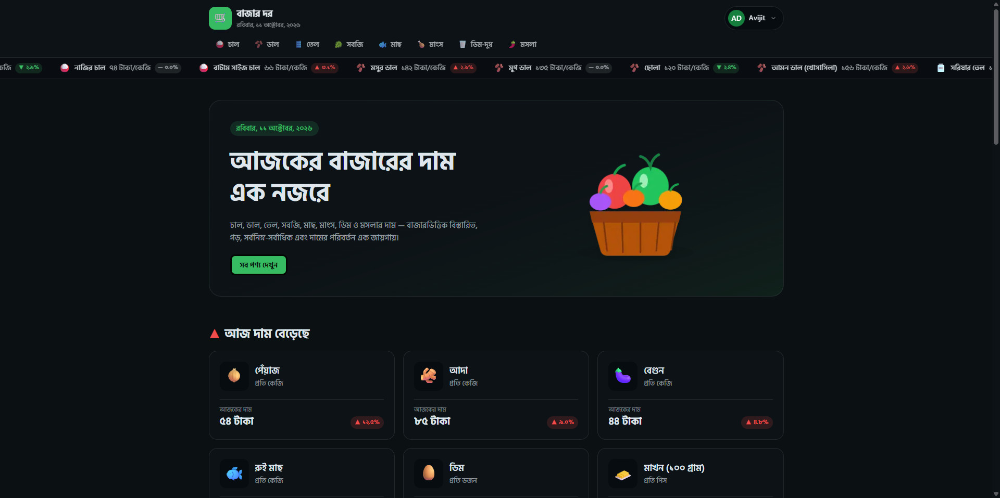
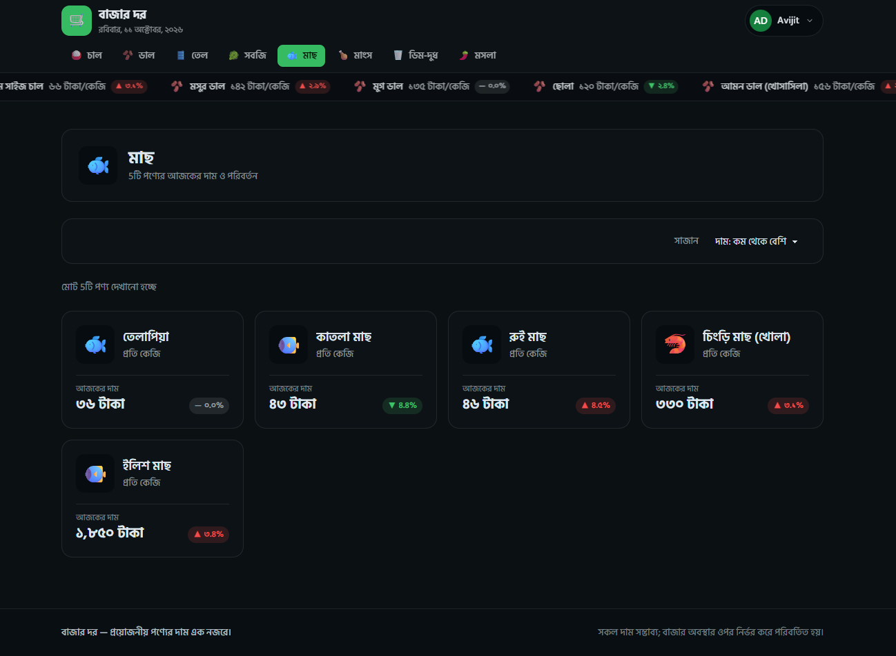
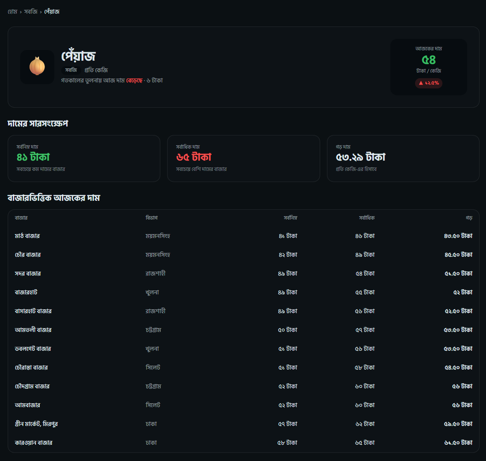
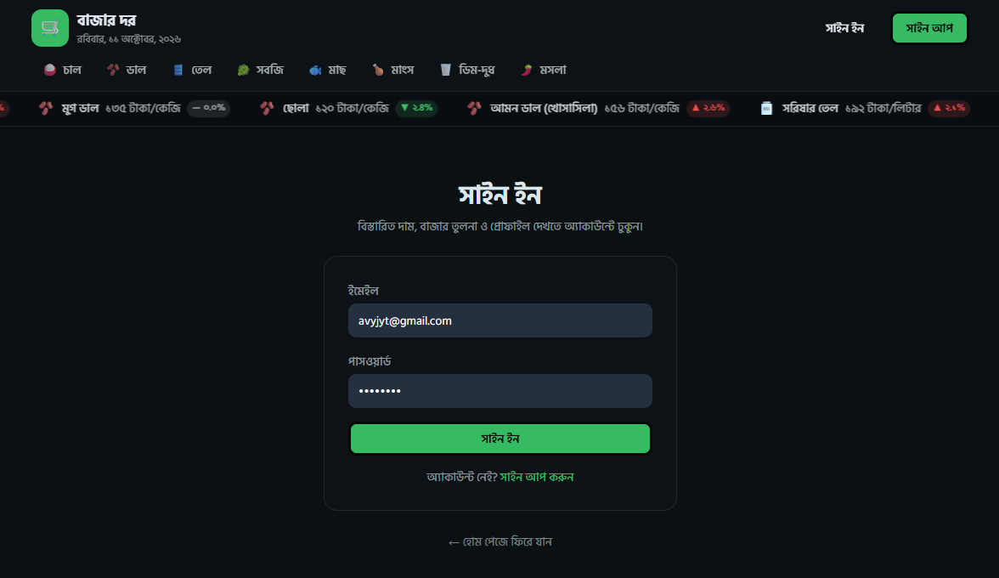
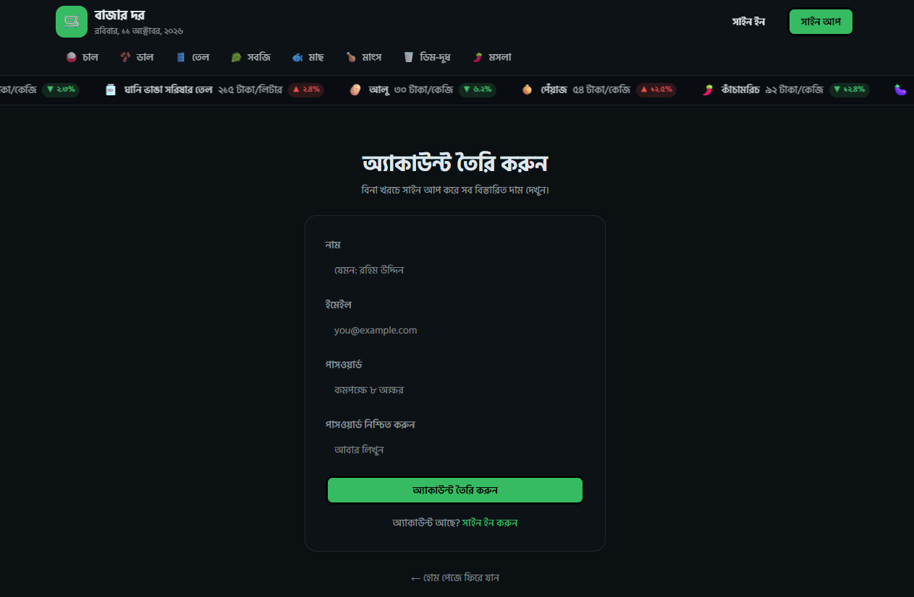
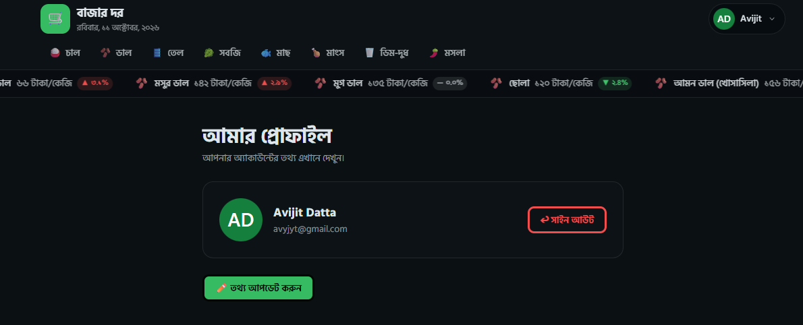

# 🛒 BazarDor — Daily Market Price Tracker

**Track today's essential grocery prices across Bangladesh — fast, in Bangla.**

A sleek **Next.js + TypeScript** price-tracking app that pulls product data from a **live REST API**,
shows **today's price movers**, lets you **browse and sort by category**, and protects detailed
market-wise prices behind **BetterAuth** authentication.

🔗 [**Live Demo**](https://bazar-dor-ad.vercel.app/) &nbsp;•&nbsp; 📦 [**Repository**](https://github.com/Avijit-Datta/BazarDor-ad)

---

## 📖 About the Project

**BazarDor (বাজার দর)** is a dark-themed, fully responsive web app for tracking the daily market prices of
everyday essentials in Bangladesh — rice, pulses, oil, vegetables, fish, meat, eggs & dairy, and spices.

Visitors can **browse products by category**, **sort by price**, and see which items **went up or down today**
in a live navbar ticker and on the home page. After **signing in**, users unlock a **detailed product page**
with the lowest, highest and average price plus a **market-by-market price table**.

The app was originally built as a Vite + React SPA and has been **rebuilt with Next.js App Router** —
server-rendered pages, streaming with loading skeletons, and **real authentication with BetterAuth**
(email & password, plus Google and GitHub sign-in).

Data is loaded from a **live REST API**:

- All products: `https://openapi.programming-hero.com/api/bazardor/products`
- All categories: `https://openapi.programming-hero.com/api/bazardor/categories`

---

## 🖼️ Screenshots

<table>
  <tr>
    <td align="center" width="33%">
      <strong>Home — Today's Movers</strong> 
      
    </td>
    <td align="center" width="33%">
      <strong>Category • Sort by Price</strong> 
      
    </td>
    <td align="center" width="33%">
      <strong>Product Details (Protected)</strong> 
      
    </td>
  </tr>
  <tr>
    <td align="center" width="33%">
      <strong>Sign In</strong> 
      
    </td>
    <td align="center" width="33%">
      <strong>Sign Up</strong> 
      
    </td>
    <td align="center" width="33%">
      <strong>My Profile</strong> 
      
    </td>
  </tr>
</table>

---

## 🛠️ Technology Used

- ▲ **Next.js 16 (App Router)** — routing, server rendering, streaming + build tool
- ⚛️ **React 19** + **TypeScript** — UI + type safety
- 🎨 **Tailwind CSS v4** + **daisyUI 5** — styling, custom dark theme and responsive layout
- 🔐 **BetterAuth** — email/password and Google / GitHub authentication
- 🐘 **PostgreSQL (Neon)** — stores users and sessions
- 🔔 **React Hot Toast** — toast notifications
- 🔤 **next/font** — self-hosted Hind Siliguri font for crisp Bangla text

---

## ✨ Features

1. **🌐 Live REST API prices**
   Browse real product data fetched from a public API (cached for 5 minutes, with an automatic fallback server).

2. **📈 Today's price movers**
   A scrolling navbar ticker plus the **Top 6 price rises** and **Top 6 price drops** on the home page.

3. **🗂️ Category browsing + sorting**
   Dedicated pages for every category with **default / low-to-high / high-to-low** sorting.

4. **🔒 Protected product details**
   Signed-out visitors are redirected to Sign In and brought **back to the same page** afterwards.
   The page shows **min / max / average** prices and a **market-wise price table**.

5. **🔑 Complete authentication with BetterAuth**
   **Email & password** sign up / sign in, **Google & GitHub** login, secure cookie sessions stored in PostgreSQL,
   and route protection on both the proxy and the server.

6. **👤 Profile management**
   View your account details and **update your name** (avatar updates automatically).

7. **⏳ Loading, empty & error states**
   Skeleton loaders, friendly empty states, custom **404** pages and a **retry** option when the API is unreachable.

8. **📱 Responsive Bangla UI**
   Dark theme that adapts from mobile to desktop, with Bangla numerals, dates (Dhaka time) and units.

---

## 🔗 Links

- **GitHub Repository:** https://github.com/Avijit-Datta/BazarDor-ad
- **Live Site:** https://bazar-dor-ad.vercel.app/

---